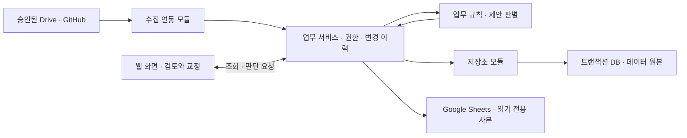

# AX 프로젝트 관리장 기획안

기준 시점 **2026-11-19 11:00 KST 전후** · [현상황](PROJECT_STATUS.md) · [요구사항 추적표](REQUIREMENTS_TRACEABILITY.md)

## 목적과 파일럿 범위

AX팀이 프로젝트별 진행 상황, 작업 책임자, 실제 기여자, 산출물 근거를 한 곳에서 확인하고 다음 업무를 배분할 수 있게 한다. 팀원은 잘못 연결된 근거를 교정하고, 담당자는 완료 판단을 제안하며, 프로젝트 책임자는 근거를 보고 확정한다. 프로젝트 책임자와 작업 실행자는 각각 별도로 기록한다.

첫 버전은 AX팀 파일럿이다. **프로젝트 → 태스크 → 작업 내역**을 기본 계층으로 사용한다. 태스크는 기획·설계, 조사·분석, 제작·구현, 검증, 운영·지원의 공통 유형으로 분류한다. 리소스 화면은 고유 작업 내역 건수와 주간·사람·유형별 분포를 제공한다. 공동 작업은 참여자별로 표시하고 팀 합계에서 중복을 제거한다. 작업 규모가 다른 점을 화면에 안내한다. 계획·확인·잔여 공수와 가용량은 후속 단계의 별도 기록이다. [제품 브리프](../01-product-brief.md) · [결정 목록](../decisions/README.md)

## 업무 흐름과 데이터

| 단계 | 처리와 책임 |
|---|---|
| 수집 | 승인된 계정·프로젝트 범위에서 가져온 이벤트에 원본, 행위자, 발생 시각, 수집 시각을 연결한다. |
| 정규화 | 원본 객체(Source), 발생 이벤트(SourceEvent), 사람이 수행한 업무 기록(WorkLog)을 각각 관리한다. 같은 키와 내용은 중복 처리하지 않고, 같은 키의 다른 내용은 변형으로 보존해 검토에 보낸다. |
| 연결 판단 | 기존 작업에 근거 추가, 새 작업 내역, 새 태스크 필요 여부를 판단한다. 허용 목록의 좁은 조건에서만 자동 연결하고 나머지는 검토 대상으로 올린다. 세부 정책은 OD-14·15에서 확정한다. |
| 검토·확정 | 사용자가 제안을 수정·거절·재연결한다. 거절한 근거가 재수집 때 자동 연결되지 않도록 억제 규칙을 보존한다. 완료 제안은 담당자 판단과 책임자 확정을 거치며 자기 승인·대리·재판단도 이력에 남긴다. |
| 조회·배분 | 보존된 연결과 확정 상태를 프로젝트·주간 화면에 표시한다. 자료 접근 불가와 행위자·시각 미상은 명시하고, 정확한 실행 시각을 알 수 없는 기록을 시간대별 집계에서 구분한다. |

[논리 모델](../design/m1-01-logical-model.md) · [완료 상태 전이](../design/m1-02-completion-state.md) · [판별 설계](../design/m1-03-matching-and-automation.md)

## 목표 아키텍처와 현행 구현

| 구성요소 | 목표 역할 | 기준 시점 구현 |
|---|---|---|
| 웹 화면과 화면 어댑터 | 프로젝트·주간·자료·검토 화면, 조회 결과를 화면 형식으로 변환 | 기존 화면과 합성 데이터 기반 어댑터. URL로 켜는 M2 로컬 모드가 JSON API에 연결된다. |
| API와 업무 서비스 | 요청 처리, 역할 확인, 버전 충돌, 재시도 및 변경 이력의 일관성 | M2 로컬 API와 분산 조율 코드. M3 업무 서비스와 화면 연결 완료는 확인 불가. |
| 업무 규칙 | 완료 전이, 동일 업무 판별, 자동 허용·억제 범위 | M2 규칙과 모의 LLM. M3 규칙 분리 착수. |
| 저장소 | 업무 변경을 한 트랜잭션으로 적용. 요청 결과와 이력을 함께 저장 | M2 행 단위 JSON이 비교용으로 존재. M3 SQLite 초기 스키마·저장 코드와 기초 롤백 검증이 확인됐다. |
| 외부 연동과 내보내기 | 외부 이벤트 수집, 실패 복구, 권한을 적용한 단방향 Sheets 공유 | 문서 조사 및 합성 데이터 정규화. 실제 커넥터와 Sheets 내보내기 구현 근거 없음. |

[화면 코드](../../app/src/app.ts) · [M2 로컬 API](../../app/poc/server.cjs) · [M3 저장소](../../app/server/repo/sqlite/index.cjs) · [M3 설계 v2](../design/m3-data-architecture.md)

## 기능·비기능 요구사항

- **기능** — 프로젝트·태스크·작업 내역·근거 조회, 주간 작업 집계, 자동 연결 제안과 사람 교정, 완료 판단과 승인, 감사 이력, 마지막 성공 갱신 시각과 실패 상태 제공.
- **데이터 정확성** — 중복 이벤트와 재시도는 중복 결과를 만들지 않는다. 버전이 어긋나면 충돌을 표시한다. 업무 변경은 전체 반영 또는 전체 취소로 처리한다. 수집 페이지에서는 이벤트·처리 대기·커서를 함께 저장한다.
- **보호·인가** — 최소 권한, 팀·프로젝트 범위 검사, 열람·내보내기 감사. 업무 사건과 삭제할 수 있는 보호 내용을 분리하고, AI 대화 원문의 자동 수집을 제외한다. 구체적 보존 기간·권한 상실·백업 만료 정책은 G2 전에 결정한다.
- **운영·검증** — 번호가 붙은 스키마 변경, 백업·복원·참조 검사, 기존 화면 회귀 기준 유지, PostgreSQL 계약 테스트와 합성 데이터 이관 연습을 실데이터 전에 완료. 조회 p95 1초는 M3 측정 가설이다.
- **파일럿 수용 기준** — 허용된 소스 2개 연계, 중복 이벤트 생성 방지, 제안 수정·거절·재연결, 권한 범위 검사, 태스크별 근거 추적. 실제 자동 판별 정확도 목표는 표본과 라벨 기준을 확인한 후 합의한다.

[완료 기준](../05-acceptance-and-metrics.md) · [보호 원칙](../decisions/ADR-007-protection-principles.md) · [추적표](REQUIREMENTS_TRACEABILITY.md)

## 외부 시스템과 승인

| 시스템 | 범위와 방식 |
|---|---|
| Google Drive | 파일럿 소스. 기존 조사안은 Changes API로 변경을 증분 조회하고 Activity API로 행위 근거를 확인한다. 알림 후 조회, 토큰 만료·재동기화, 제한 스코프와 승인 범위를 검증한다. |
| GitHub | 파일럿 소스. 조사안은 승인 저장소에 GitHub App 읽기 권한을 부여하고 push·PR 이벤트를 수집한다. 서명 검증과 전송 ID 중복 방지, 실제 업무 실행자 매핑이 필요하다. |
| Google Sheets | 거래가 확정된 DB에서 필드별 권한을 적용한 조회 사본을 단방향으로 내보낸다. 원본은 앱에서 교정한다. |
| Calendar·Chat·Gmail | 확장 검토 범위. Calendar·Chat 조사 기록이 있으며, 실연동 우선순위는 미정이다. |
| LLM | 합성 단계는 모의 응답을 사용한다. 실사용 모델·공유 필드·비용·평가 기준은 확인 불가다. 완료는 근거와 함께 제안한다. |

G0은 로컬 합성 데이터, G1은 별도 승인된 외부 시험 쓰기, G2는 별도 승인된 시험 사용자 데이터, G3는 파일럿 평가 후 승인받는 운영 배포다. 실제 API 권한과 앱 검증 조건은 기존 조사 근거이며 연동 착수 전에 다시 확인한다. [연동 조사](../research/m1-04-integration-research.md) · [승인 게이트](../decisions/ADR-010-approval-gates.md)

## 주요 설계 결정

| 결정 | 이유 |
|---|---|
| AX팀 파일럿, 3단계 업무 계층, 건수 우선(ADR-001~003) | 실무에 필요한 조회부터 검증하고 공수의 과잉 해석을 줄인다. |
| 원본·이벤트·작업 내역 분리, 사람 교정(ADR-004·008·012) | 한 원본의 여러 발생 이력 및 관계를 보존하고 잘못된 연결을 되돌릴 수 있다. |
| AI 원문 제외, 사람이 완료 확정, 접근 감사(ADR-005~007) | 개인 대화와 보호 정보 노출을 줄이며 책임과 판단 근거를 남긴다. |
| 생성물 추적과 단계별 승인(ADR-009·010) | 기존 UI 실행 형태를 검증하고 외부 접근 권한을 단계별로 통제한다. |
| Drive + GitHub(ADR-011) | 문서와 개발 활동을 각각 대표하는 두 소스를 검증한다. |
| DB 원본 + 읽기 전용 Sheets(ADR-013) | 여러 행을 따로 쓰던 M2에서 예약과 복구 복잡성이 반복됐다. M3 v2는 합성 단계 SQLite, 실연동 전 PostgreSQL을 제안한다. 운영 제품·배치는 ADR-014에서 정한다. |

[ADR 전체](../decisions/README.md) · [저장소 비교 기록](../design/m2-storage-direction.md)